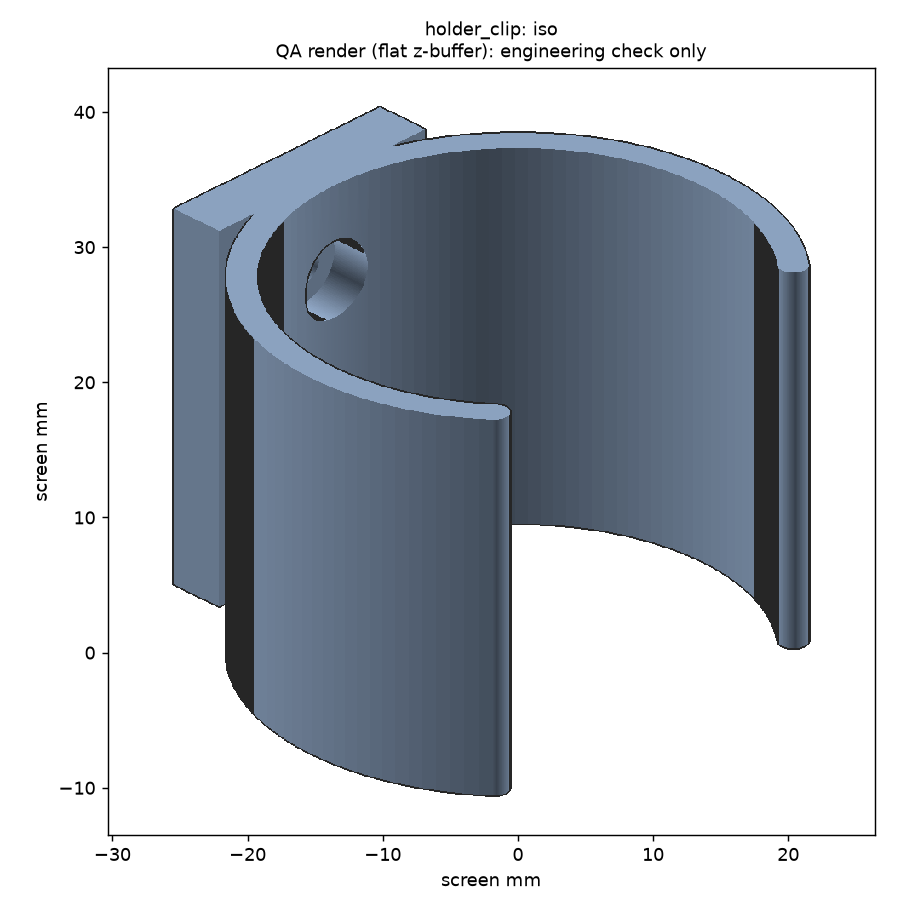
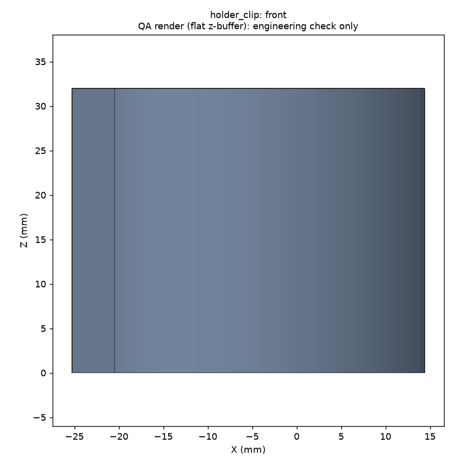
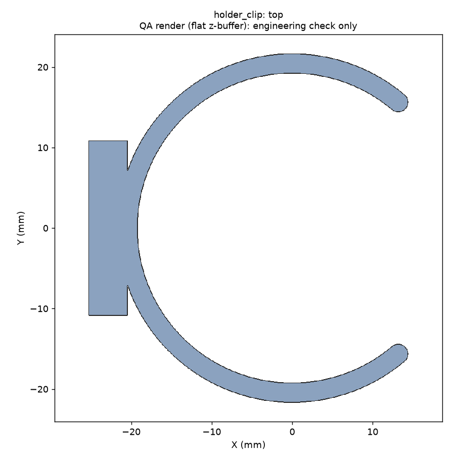
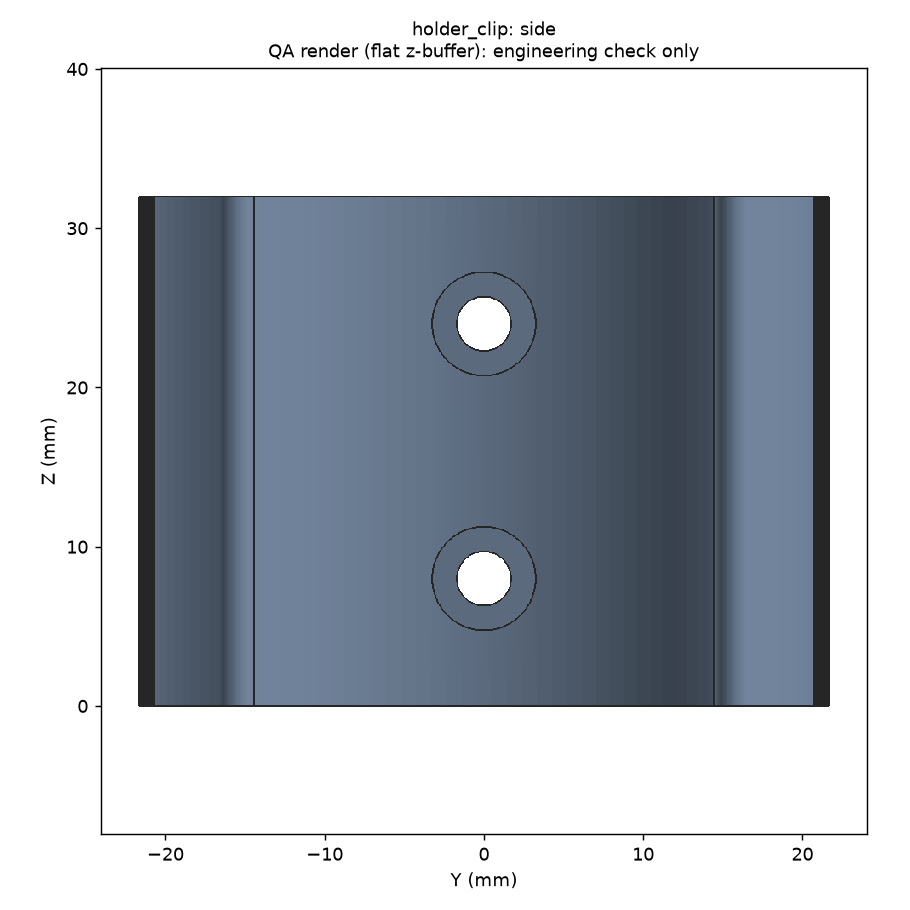
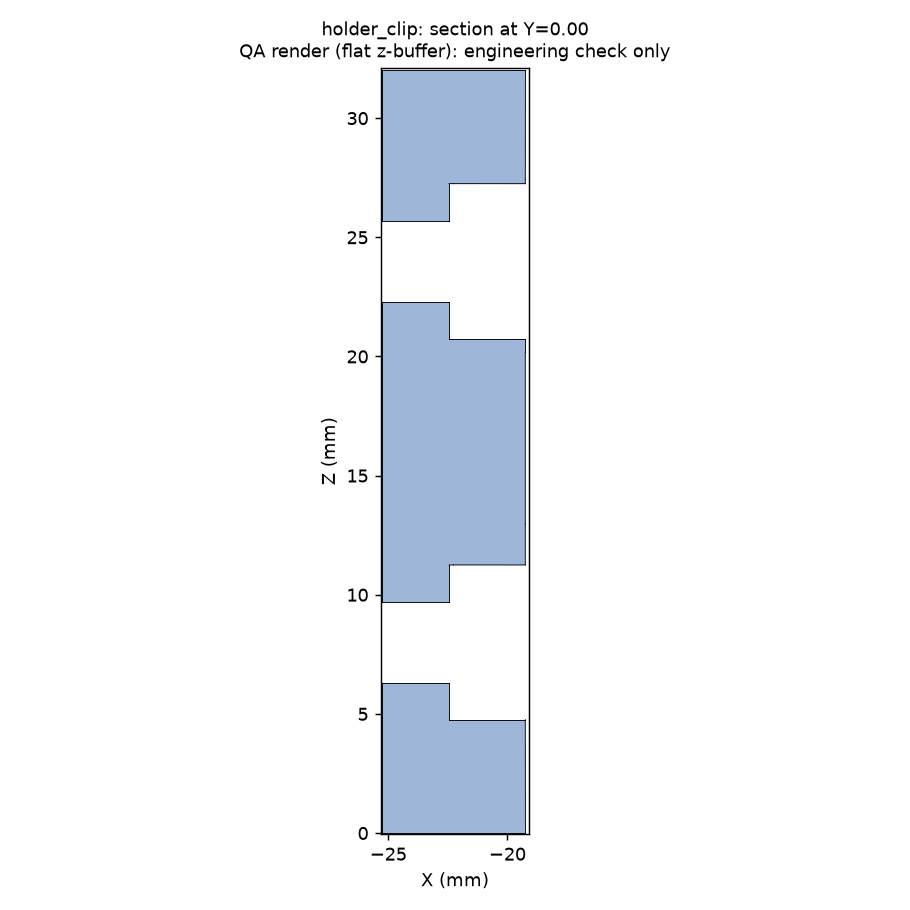

# Magic CAD report: holder_clip.py

**Overall: PASS**  
Command: `magic.py run designs/holder_clip.py --out runs/holder_clip`  
Brief: `/workspace/CAD-ADE/briefs/holder_clip.yaml`  
Parameters: `{"barrel_dia": 38.0, "clearance": 0.25, "clip_height": 32.0, "wall": 2.4}`

## Checks

| Gate | Status | Detail |
|---|---|---|
| 1 Execute | PASS | built in 2.62 s; no hard-coded literals |
| 2 Geometry | PASS | 1/1 solids, volume 9970 mm³, 2/2 dims in ±0.1 |
| 3 Printability | PASS | watertight, single component, fits bed; overhang brief 11.5 %, support risk 11.7 % |
| 4 Renders | PASS | 5 PNGs from reloaded STL |
| Sweep | PASS | 15/15 pass; dead params: none |
| 5 Exports | PASS | holder_clip.stl, holder_clip.step |

## Measured vs spec (reloaded STEP, ±0.1 mm)

| Dimension | Spec | Measured | Delta | Result |
|---|---|---|---|---|
| clip_height | 32.000 | 32.000 | 0.000 | PASS |
| mount_holes | 2.000 | 2.000 | 0.000 | PASS |

## Printability: holder_clip (reloaded STL)

- Watertight: True; components: 1; faces: 3400
- Extents: 39.63 x 43.30 x 32.00 mm; fits 250x250 bed: True
- Brief overhang metric (downward faces >45° from straight down): 11.54 %
- Support-risk metric (within 45° of straight down, off the bed): 11.66 %
- Flat undersides above bed: 0.46 mm²; bed contact: 320 mm²
- Thinnest section (approximate, section sampling): ~2.4 mm (step 0.4; short tabs read high) at {'axis': 'X', 'offset': -2.96}

## Parameter sweep

**15/15 samples pass** (share 100%, required 100%). Dead params: none. Printability, informational: 15/15 pass; worst support risk 14.7 %, worst brief overhang 14.6 %.

| Sample | Result | Volume mm³ | Printable | Problems |
|---|---|---|---|---|
| default | PASS | 9970 | True | - |
| barrel_dia=min | PASS | 7981 | True | - |
| barrel_dia=max | PASS | 12958 | True | - |
| clearance=min | PASS | 9895 | True | - |
| clearance=max | PASS | 10194 | True | - |
| clip_height=min | PASS | 8690 | True | - |
| clip_height=max | PASS | 12530 | True | - |
| wall=min | PASS | 8191 | True | - |
| wall=max | PASS | 12712 | True | - |
| all=min | PASS | 5629 | True | - |
| all=max | PASS | 20974 | True | - |
| combo1 | PASS | 14594 | True | - |
| combo2 | PASS | 18750 | True | - |
| combo3 | PASS | 9481 | True | - |
| combo4 | PASS | 9871 | True | - |

## Assumptions surfaced

- Clip fit, retention, and screw access are not measured by the harness and need physical testing.
- Printer and clearance values are placeholders.

## Renders (flat QA renders)

