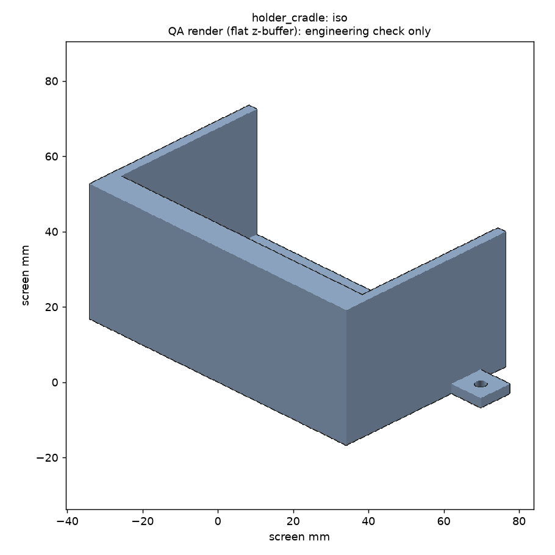
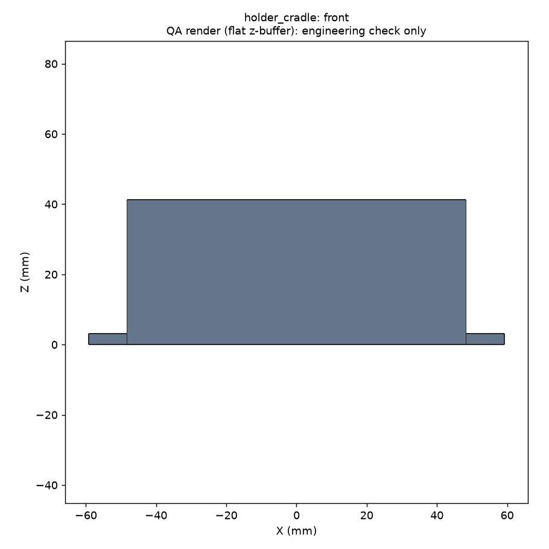
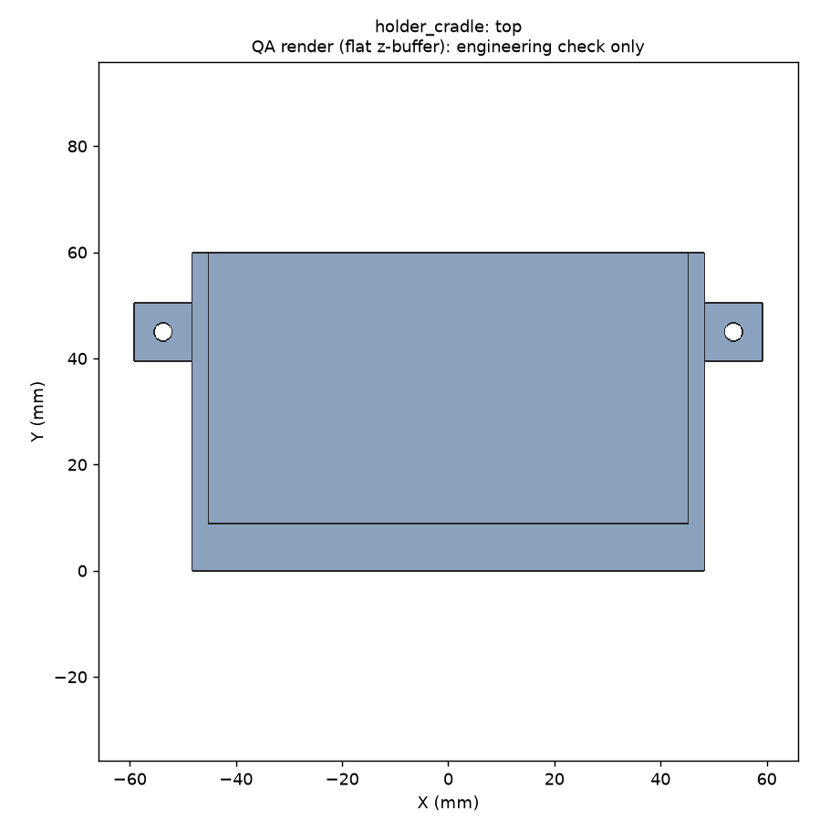
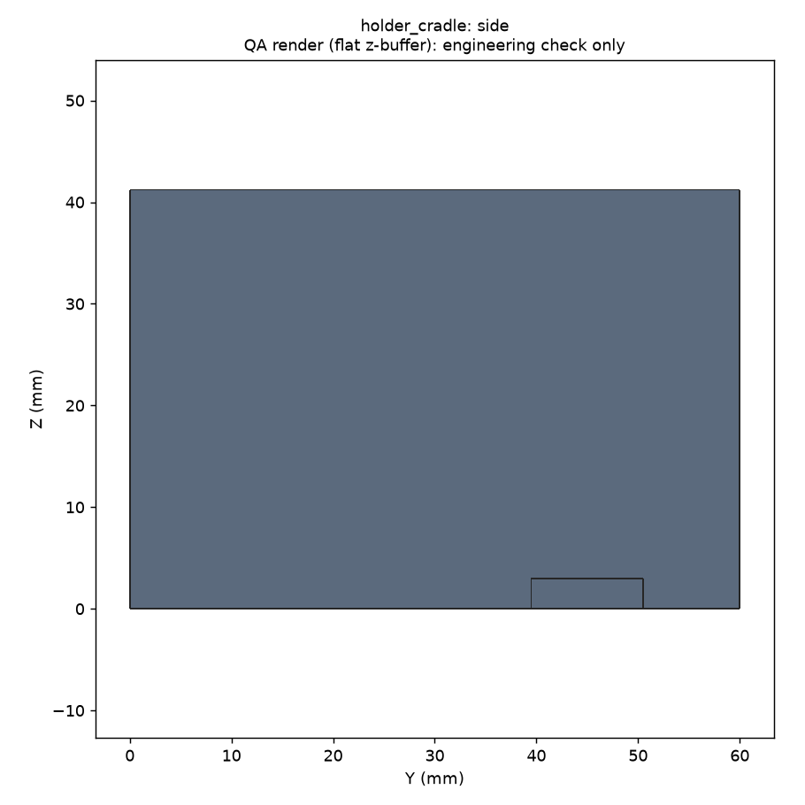
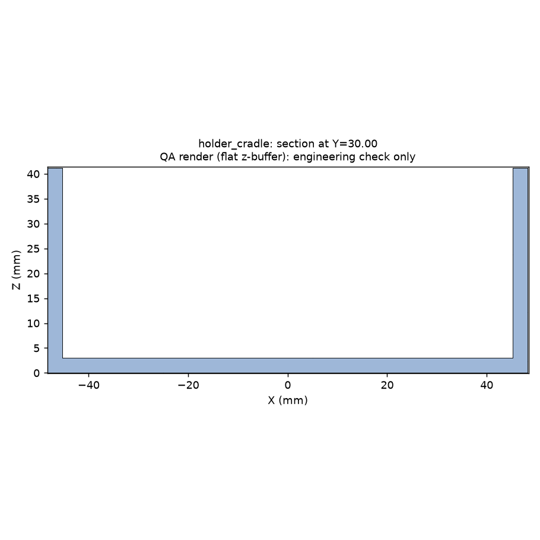

# Magic CAD report: holder_cradle.py

**Overall: PASS**  
Command: `magic.py run designs/holder_cradle.py --out runs/holder_cradle`  
Brief: `/workspace/CAD-ADE/briefs/holder_cradle.yaml`  
Parameters: `{"obj_w": 90.0, "obj_d": 35.0, "obj_h": 120.0, "clearance": 0.25, "wall": 3.0}`

## Checks

| Gate | Status | Detail |
|---|---|---|
| 1 Execute | PASS | built in 2.53 s; no hard-coded literals |
| 2 Geometry | PASS | 1/1 solids, volume 53396 mm³, 1/1 dims in ±0.1 |
| 3 Printability | PASS | watertight, single component, fits bed; overhang brief 0.0 %, support risk 4.3 % |
| 4 Renders | PASS | 5 PNGs from reloaded STL |
| Sweep | PASS | 17/17 pass; dead params: none |
| 5 Exports | PASS | holder_cradle.stl, holder_cradle.step |

## Measured vs spec (reloaded STEP, ±0.1 mm)

| Dimension | Spec | Measured | Delta | Result |
|---|---|---|---|---|
| mount_holes | 2.000 | 2.000 | 0.000 | PASS |

## Printability: holder_cradle (reloaded STL)

- Watertight: True; components: 1; faces: 1084
- Extents: 118.50 x 60.00 x 41.25 mm; fits 250x250 bed: True
- Brief overhang metric (downward faces >45° from straight down): 0.00 %
- Support-risk metric (within 45° of straight down, off the bed): 4.32 %
- Flat undersides above bed: 271.50 mm²; bed contact: 6014 mm²
- Thinnest section (approximate, section sampling): ~2.8 mm (step 0.5; short tabs read high) at {'axis': 'Y', 'offset': 11.25}

## Parameter sweep

**17/17 samples pass** (share 100%, required 100%). Dead params: none. Printability, informational: 17/17 pass; worst support risk 8.3 %, worst brief overhang 0.0 %.

| Sample | Result | Volume mm³ | Printable | Problems |
|---|---|---|---|---|
| default | PASS | 53396 | True | - |
| obj_w=min | PASS | 40841 | True | - |
| obj_w=max | PASS | 65951 | True | - |
| obj_d=min | PASS | 39851 | True | - |
| obj_d=max | PASS | 66941 | True | - |
| obj_h=min | PASS | 43016 | True | - |
| obj_h=max | PASS | 61181 | True | - |
| clearance=min | PASS | 53135 | True | - |
| clearance=max | PASS | 54181 | True | - |
| wall=min | PASS | 41980 | True | - |
| wall=max | PASS | 73240 | True | - |
| all=min | PASS | 17946 | True | - |
| all=max | PASS | 127602 | True | - |
| combo1 | PASS | 94170 | True | - |
| combo2 | PASS | 59888 | True | - |
| combo3 | PASS | 27186 | True | - |
| combo4 | PASS | 70449 | True | - |

## Assumptions surfaced

- Internal fit, screw access, retention, and load capacity are not measured by the harness and need physical testing.
- Printer and clearance values are placeholders.

## Renders (flat QA renders)

