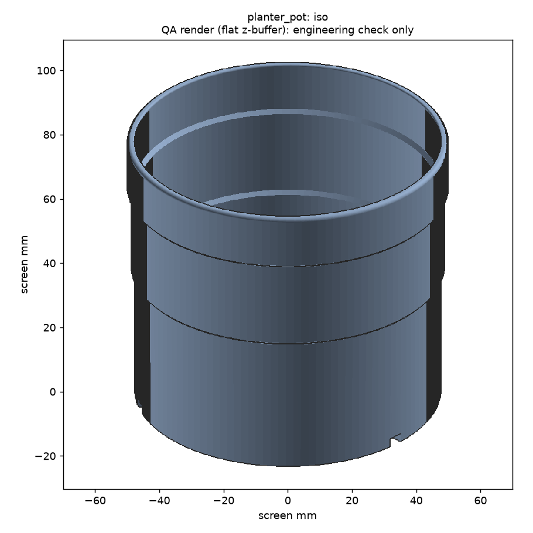
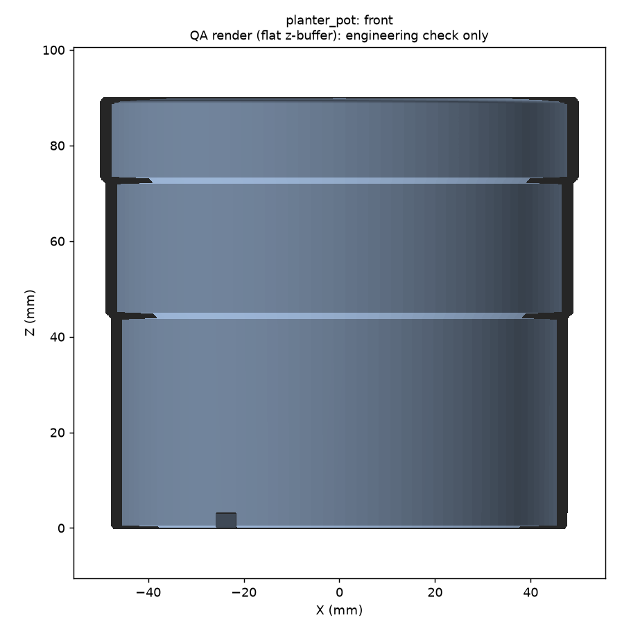
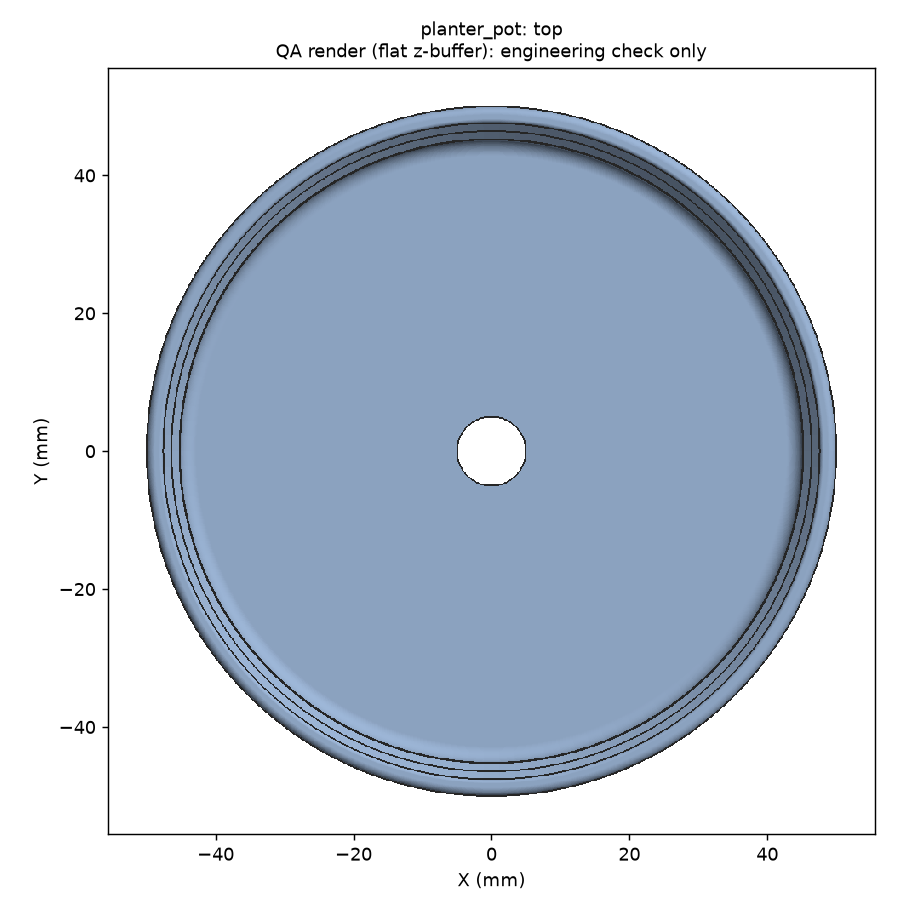
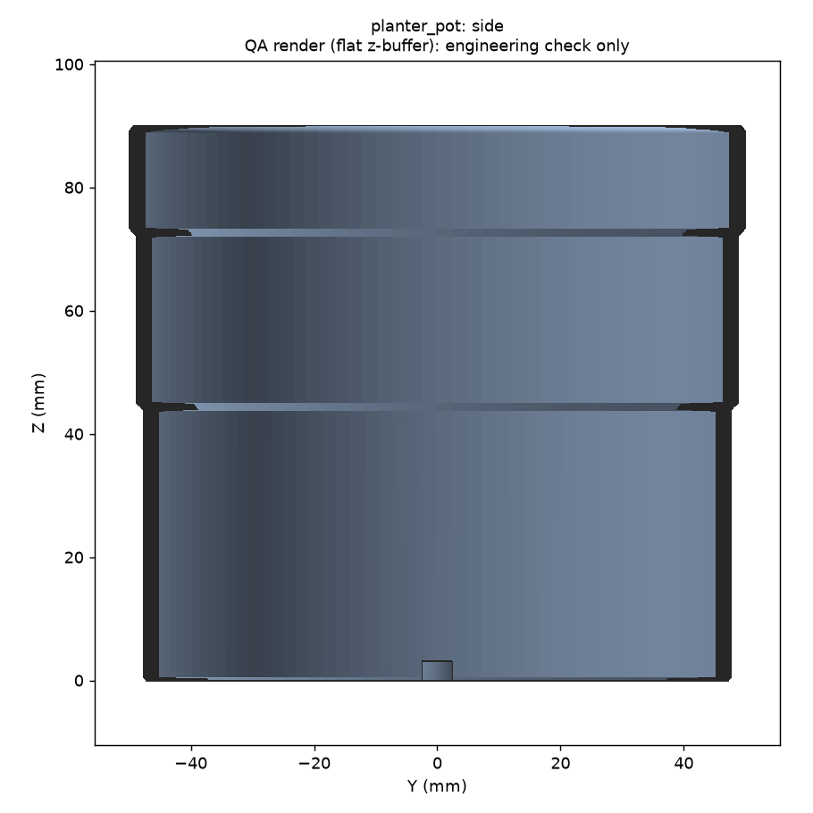
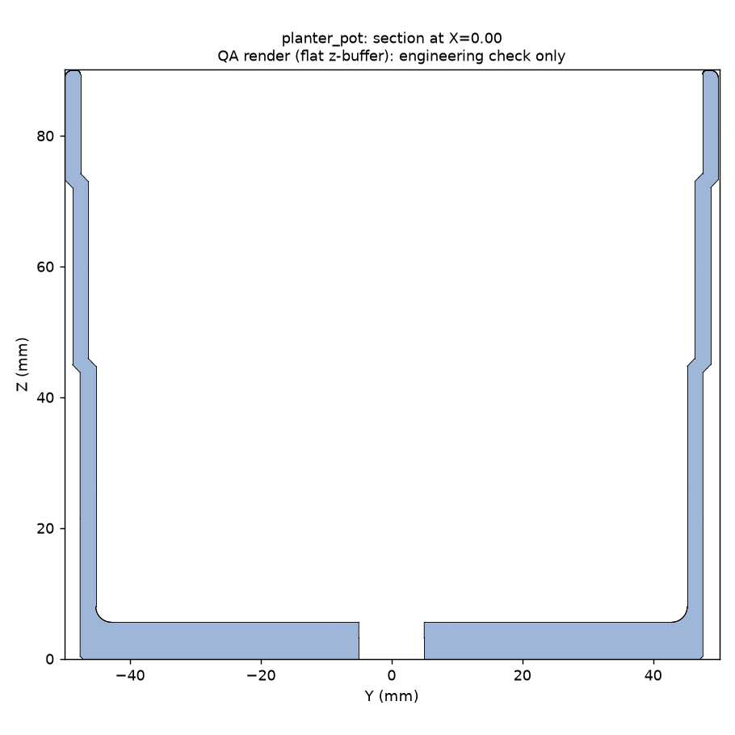

# Magic CAD report: planter_pot.py

**Overall: PASS**  
Command: `magic.py run designs/planter_pot.py --brief evals/briefs/planter_pot.yaml`  
Brief: `evals/briefs/planter_pot.yaml`  
Parameters: `{"rim_dia": 100.0, "height": 90.0, "taper_deg": 1.5, "wall": 2.4}`

## Checks

| Gate | Status | Detail |
|---|---|---|
| 1 Execute | PASS | built in 2.67 s; no hard-coded literals |
| 2 Geometry | PASS | 1/1 solids, volume 98538 mm³, 3/3 dims in ±0.1 |
| 3 Printability | PASS | watertight, single component, fits bed; overhang brief 12.8 %, support risk 9.8 % |
| 4 Renders | PASS | 5 PNGs from reloaded STL |
| Sweep | PASS | 15/15 pass; dead params: none |
| 5 Exports | PASS | pot.stl, pot.step |

## Measured vs spec (reloaded STEP, ±0.1 mm)

| Dimension | Spec | Measured | Delta | Result |
|---|---|---|---|---|
| rim_dia | 100.000 | 100.000 | 0.000 | PASS |
| height | 90.000 | 90.000 | 0.000 | PASS |
| drain_holes | 1.000 | 1.000 | 0.000 | PASS |

## Printability: pot (reloaded STL)

- Watertight: True; components: 1; faces: 28028
- Extents: 100.00 x 99.97 x 90.00 mm; fits 250x250 bed: True
- Brief overhang metric (downward faces >45° from straight down): 12.79 %
- Support-risk metric (within 45° of straight down, off the bed): 9.83 %
- Flat undersides above bed: 642.54 mm²; bed contact: 6294 mm²
- Thinnest section (approximate, section sampling): ~2.4 mm (step 0.4; short tabs read high) at {'axis': 'X', 'offset': -18.75}

## Parameter sweep

**15/15 samples pass** (share 100%, required 100%). Dead params: none. Printability, informational: 15/15 pass; worst support risk 14.4 %, worst brief overhang 13.6 %.

| Sample | Result | Volume mm³ | Printable | Problems |
|---|---|---|---|---|
| default | PASS | 98538 | True | - |
| rim_dia=min | PASS | 59739 | True | - |
| rim_dia=max | PASS | 201980 | True | - |
| height=min | PASS | 78628 | True | - |
| height=max | PASS | 140902 | True | - |
| taper_deg=min | PASS | 101962 | True | - |
| taper_deg=max | PASS | 98538 | True | - |
| wall=min | PASS | 73198 | True | - |
| wall=max | PASS | 123207 | True | - |
| all=min | PASS | 35051 | True | - |
| all=max | PASS | 334599 | True | - |
| combo1 | PASS | 345867 | True | - |
| combo2 | PASS | 244220 | True | - |
| combo3 | PASS | 204392 | True | - |
| combo4 | PASS | 101587 | True | - |

## Assumptions surfaced

- Size is a guess for a 10 cm herb pot.
- PLA softens in direct summer sun; use PETG outdoors. Unverified here.

## Renders (flat QA renders)

